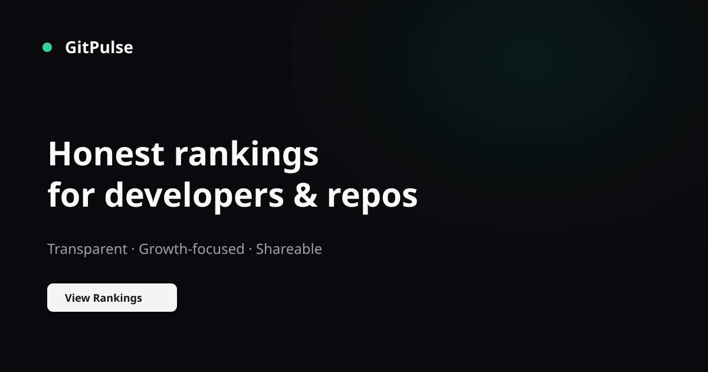

# GitPulse

**Honest rankings for developers and repositories on GitHub.**

Transparent methodology · Growth-focused · Shareable cards · Weekly pulse

[](https://gitpulse-ppiiyo.vercel.app)
[](https://nextjs.org)
[](./LICENSE)

**→ [Open product](https://gitpulse-ppiiyo.vercel.app)**

<p align="center">
  
</p>

---

## What is GitPulse?

GitPulse ranks GitHub developers and repositories using a clear, public formula that prioritizes **recent growth and real activity** — not just lifetime stars.

- Developer rankings (Overall + Growth)
- Repository rankings (Overall + Fastest Growing)
- Shareable ranking cards
- Weekly Pulse
- Personal report lookup (`/report?u=username`)

## Ranking Methodology (MVP)

### Developers

```
DeveloperScore =
  0.35 × StarsScore +
  0.30 × GrowthScore +
  0.20 × ActivityScore +
  0.15 × ImpactScore
```

### Repositories

```
RepoScore =
  0.25 × Stars +
  0.40 × StarsGrowth +
  0.25 × Activity +
  0.10 × QualityScore
```

Full details: [`docs/methodology.md`](./docs/methodology.md)

## Local Development

```bash
npm install
npm run dev
```

### Seed data

```bash
export GITHUB_TOKEN=ghp_your_token
npm run seed    # repos + developers
```

Writes `data/snapshots/repos-YYYY-MM-DD.json` and `developers-YYYY-MM-DD.json`.
Growth (7d/30d) improves after several daily seeds.

## Daily automation

GitHub Action [`.github/workflows/daily-seed.yml`](./.github/workflows/daily-seed.yml):

- Every day 06:00 UTC (+ manual dispatch)
- Seeds repos + developers
- Commits snapshots → Vercel redeploys

Optional repo secret **`GITPULSE_GITHUB_TOKEN`**: PAT for higher GitHub API rate limits during seed.

## Deploy

**Production:** https://gitpulse-ppiiyo.vercel.app

Vercel project `gitpulse` ↔ `ppiiyo/gitpulse`. Pushes to `main` auto-deploy.

## Stack

- Next.js 16 + TypeScript + Tailwind CSS 4
- GitHub API + JSON snapshots
- Vercel + GitHub Actions

## License

MIT
